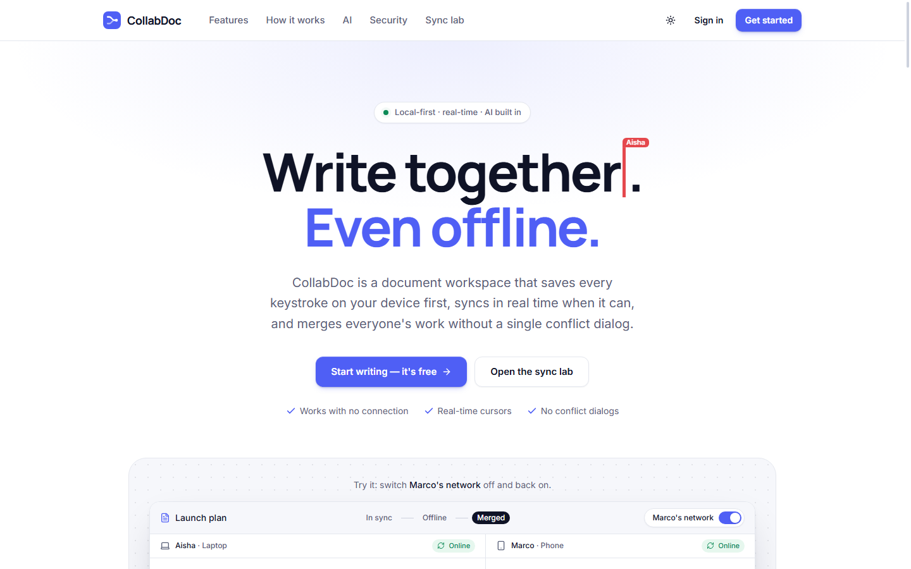
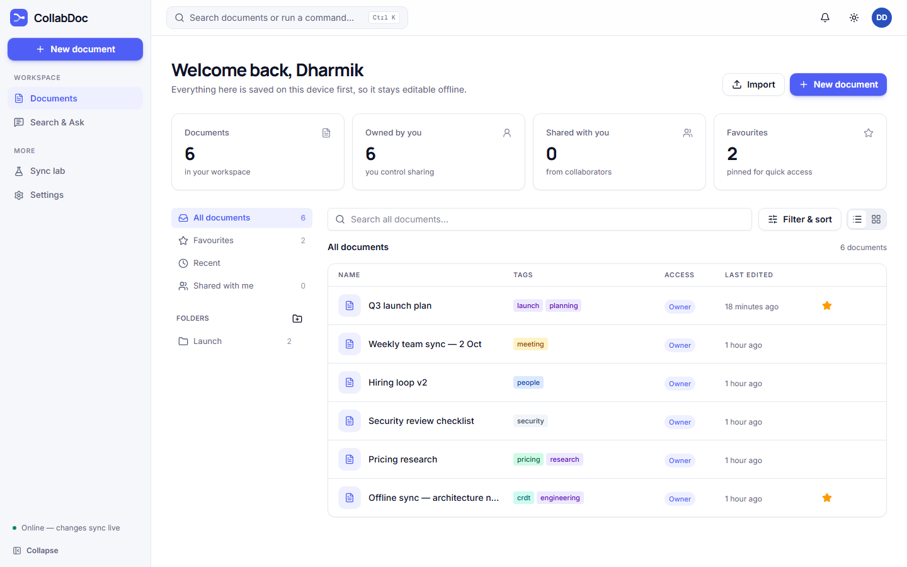
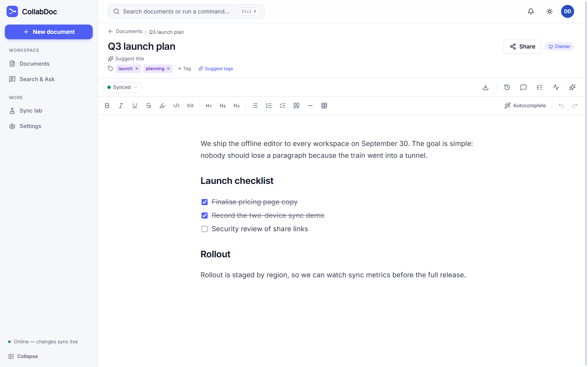
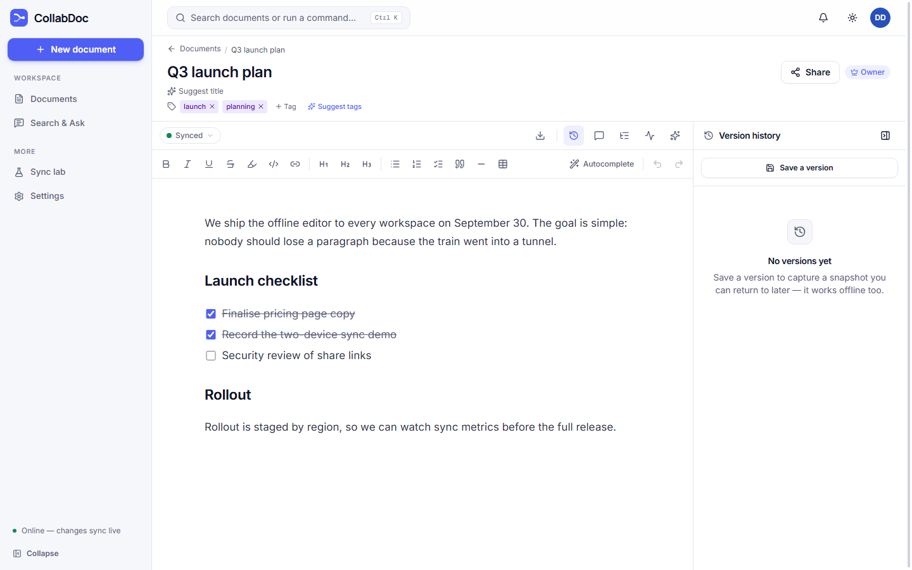
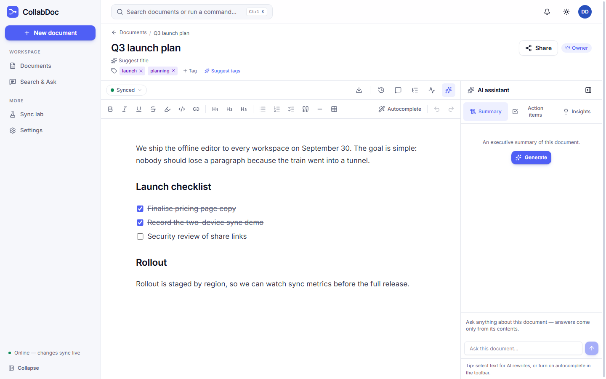
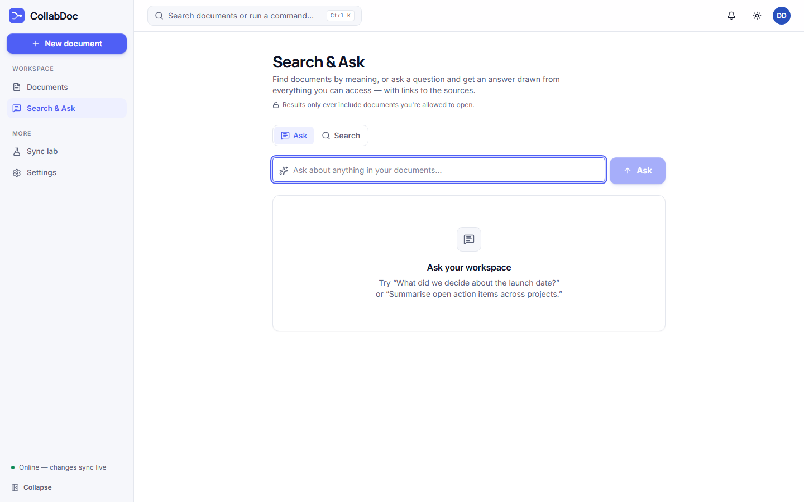
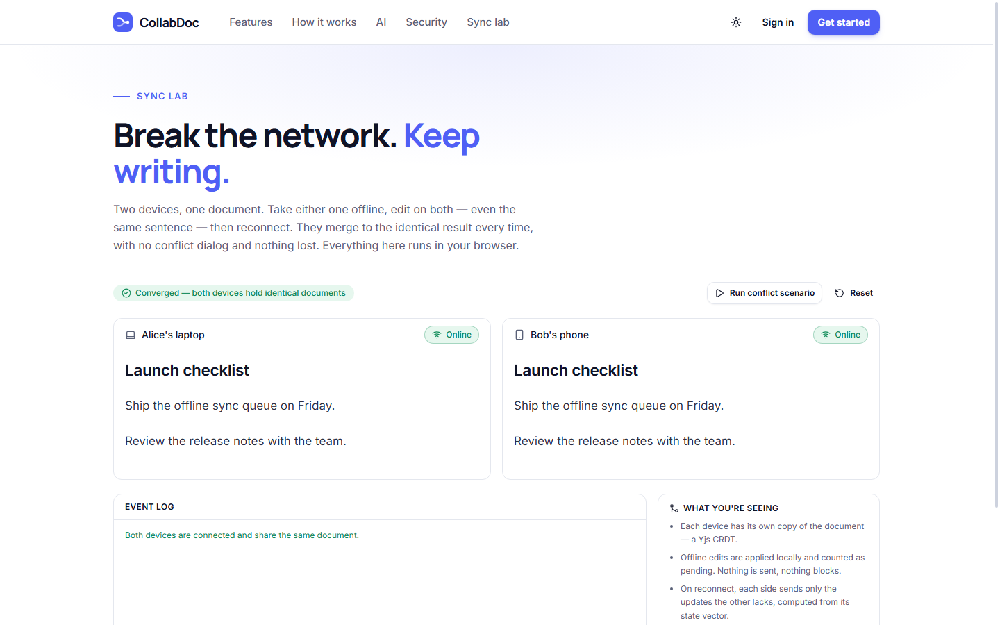
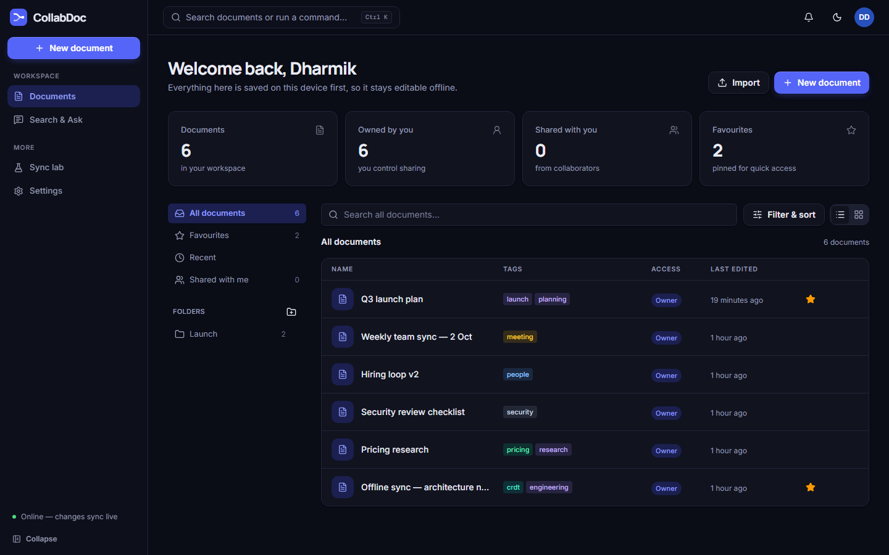
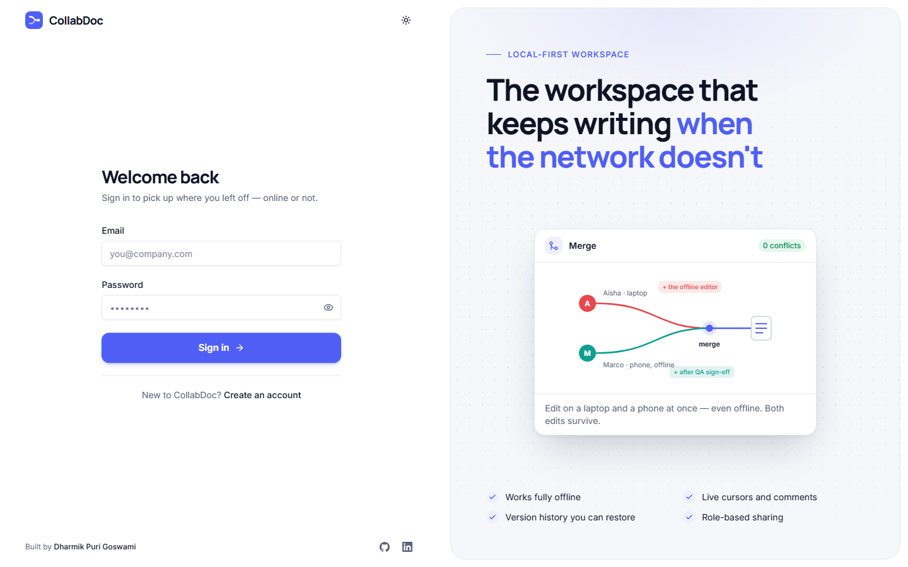

<div align="center">


# CollabDoc

**A local-first collaborative document editor.**
Write together in real time — even offline — and merge everyone's work without a single conflict dialog.

Next.js 16 · React 19 · Yjs CRDT · Hocuspocus · PostgreSQL + RLS · Auth.js · Gemini

Built for the House of EdTech Full-Stack Developer assignment by **Dharmik Puri Goswami**.

</div>



---

## Contents

- [What it does](#what-it-does)
- [Screenshots](#screenshots)
- [How the graded requirements are met](#how-the-graded-requirements-are-met)
- [Features](#features)
- [Tech stack](#tech-stack)
- [Architecture](#architecture)
- [Getting started](#getting-started)
- [Testing](#testing)
- [Offline mutation queue](#offline-mutation-queue)
- [Security and production hardening](#security-and-production-hardening)
- [Deployment](#deployment)
- [Project structure](#project-structure)
- [Scripts](#scripts)

## What it does

Most online editors wait for the server before an edit counts. CollabDoc saves every keystroke on
the device first, syncs in real time when there is a connection, and merges concurrent edits
deterministically when there isn't. Two people can edit the same paragraph — one of them offline —
and both edits survive.

On top of that sit the things a team actually needs: roles and sharing, version history with a safe
restore and a compare view, comments with @mentions, a workspace with folders and favourites, and AI
features (summaries, Q&A, semantic search across documents, rewrite, autocomplete) that never touch
the document without the user's say-so.

## Screenshots

|                                                                                       |                                                                          |
| :-----------------------------------------------------------------------------------: | :----------------------------------------------------------------------: |
|             <br>Dashboard              |           <br>Editor            |
| <br>Version history | <br>AI assistant |
|        <br>Search & Ask        |        <br>Sync lab         |
|           <br>Dark mode           |          <br>Sign in          |

More (mobile, dark mode, every landing section): [`docs/screenshots/`](docs/screenshots) — open
`index.html` there for a gallery.

## How the graded requirements are met

| Requirement                           | Where it lives                                                                                                                                                                                                                       |
| ------------------------------------- | ------------------------------------------------------------------------------------------------------------------------------------------------------------------------------------------------------------------------------------ |
| **Local-first / offline sync**        | Every keystroke is written to a local Yjs document persisted in **IndexedDB** (`y-indexeddb`). A **service worker** caches pages/assets so a document opens with no network, and edits made offline sync automatically on reconnect. |
| **Deterministic conflict resolution** | The document is a **Yjs CRDT**. Concurrent edits from any number of clients converge to the same state regardless of order or timing — no last-write-wins clobbering, no manual merge.                                               |
| **Granular version control**          | Named snapshots (stored as editor JSON) with author + timestamp. **Restore is non-destructive**: it saves the current state first, then applies the old content as a _forward edit_, so live collaborators are never overwritten.    |

## Features

**Collaboration**

- Real-time editing with live presence cursors
- Works fully offline; syncs automatically on reconnect, with visible sync status
- Per-document roles — **Owner / Editor / Viewer** — enforced in the API, the collab server and the
  database
- Share by email, or with **invite links** (Viewer/Editor role, expiry, revocation; only a SHA-256 of
  the token is stored, and joining needs an explicit click)
- **Comments & @mentions**: threads anchored to text (the anchor is a CRDT mark, so it survives
  concurrent edits), replies, resolve/reopen, and notifications for mentioned collaborators
- **Activity feed** per document, written in the same transaction as each change it records
- **Sync lab** (`/lab`, public): two simulated devices edit offline and merge live, with an
  on-the-spot proof that the merge is order-independent

**Versions**

- Named versions with safe, non-destructive restore
- Word-level **compare view** (redline or side by side) between any version and the current draft or
  another version
- AI **"What changed since?"** summaries between a version and the current draft
- **Offline mutation queue**: saving a version and renaming work offline too — see
  [below](#offline-mutation-queue)

**Writing**

- Rich editor: headings, lists, checklists, tables, links, highlight, code, quotes, and a live
  outline panel
- **Slash commands** (`/`) in the editor and a **command palette** (Ctrl/⌘+K)
- **Export** to Markdown, HTML, plain text or PDF (print); **import** Markdown as a new document

**AI (Google Gemini)**

- Assistant: executive summary, action items, key insights and grounded Q&A over the document, with
  streaming answers and a Stop button that cancels the model call end to end
- Rewrite any selection (improve / shorten / bulletize), applied as CRDT-safe edits
- Opt-in **autocomplete** as ghost text (Tab to accept); the suggestion is a decoration, never CRDT
  content
- **Title & tag suggestions**, applied only when accepted
- **Search & Ask** (`/search`): semantic search (Gemini embeddings in Postgres/pgvector, HNSW index)
  and retrieval-augmented answers across every document you can access, with citations. The
  permission join is in the SQL itself, with RLS as the backstop

Every AI surface degrades gracefully without an API key — it explains what to configure rather than
disappearing.

**Workspace**

- Dashboard with folders (drag-and-drop or "Move to"), favourites, recently opened, "shared with me"
  and tags; the active view lives in the URL
- List and grid views, search, light / dark / system theme, responsive down to mobile

## Tech stack

| Layer               | Choice                                                       |
| ------------------- | ------------------------------------------------------------ |
| Framework           | Next.js 16 (App Router, React 19, TypeScript)                |
| Styling             | Tailwind CSS v4 with design tokens; Manrope + Inter          |
| Database            | PostgreSQL (Supabase) + Prisma 6, pgvector                   |
| Auth                | Auth.js v5 (Credentials, JWT sessions)                       |
| Editor              | TipTap 3 (ProseMirror)                                       |
| Conflict resolution | Yjs (CRDT) + `y-indexeddb` for local persistence             |
| Real-time transport | Hocuspocus (Yjs WebSocket server) — a separate Node process  |
| AI                  | Google Gemini (REST), behind a swappable provider interface  |
| UI                  | Radix primitives, lucide icons, hand-built SVG illustrations |

## Architecture

```
┌──────────────────────────┐        ┌──────────────────────────┐
│  Next.js app (:3000)     │        │  Collab server (:1234)   │
│  - UI + REST API         │        │  Hocuspocus / Yjs WS     │
│  - Auth, roles, versions │        │  - verifies collab JWT   │
│  - Prisma, per-request   │        │  - relays CRDT updates   │
│    user id for RLS       │        │  - persists merged state │
└────────────┬─────────────┘        └────────────┬─────────────┘
             │                                   │
             │  short-lived JWT (role-scoped)    │
             └─────────────────┬─────────────────┘
                               ▼
                     ┌───────────────────┐
                     │  PostgreSQL       │
                     │  - app tables     │
                     │  - RLS policies   │
                     │  - CRDT state     │
                     │  - pgvector index │
                     └───────────────────┘
```

The Next app and the collaboration server are **separate processes** because a Next.js server
can't hold long-lived WebSocket connections. The browser edits a local Yjs doc; the Hocuspocus
server relays CRDT updates between clients and persists the merged state to Postgres so documents
survive restarts and new joiners load the current content.

Access is gated the same way everywhere by one capability matrix (`src/lib/authz/roles.ts`): the
REST API checks it, the collab server marks Viewer connections read-only, and **Postgres RLS
policies are a backstop** — every request runs with the caller's id in `app.user_id`, and the
policies scope each row to it. The app connects as the database owner (which bypasses RLS), so the
policies sit as defense-in-depth behind the app-layer checks and enforce for any non-owner access
path.

## Getting started

### Prerequisites

- Node.js 20.12+ (the scripts use the built-in `.env` loader)
- A PostgreSQL database — a free [Supabase](https://supabase.com) project works
- Optional: a [Google AI Studio](https://aistudio.google.com) API key for the AI features

### 1. Install dependencies

```bash
npm install               # app
npm run collab:install    # collaboration server
```

### 2. Configure environment

```bash
cp .env.example .env      # then fill in the values — each one is explained in the file
```

| Variable                            | Required | What to put there                                                             |
| ----------------------------------- | :------: | ----------------------------------------------------------------------------- |
| `DATABASE_URL`                      |   yes    | Postgres connection string (session mode, port `5432`)                        |
| `DIRECT_URL`                        |   yes    | Same as above; used by migrations                                             |
| `AUTH_SECRET`                       |   yes    | A random secret — generate one (see below)                                    |
| `COLLAB_TOKEN_SECRET`               |   yes    | Another random secret, shared with the collab server                          |
| `NEXT_PUBLIC_APP_URL`               |   yes    | `http://localhost:3000` locally, the public URL in production                 |
| `NEXT_PUBLIC_COLLAB_WS_URL`         |   yes    | `ws://localhost:1234` locally, the collab server's `wss://` URL in production |
| `GEMINI_API_KEY`                    |    no    | Enables the AI features                                                       |
| `UPSTASH_REDIS_REST_URL` / `_TOKEN` |    no    | Shares rate limits across instances (in-memory otherwise)                     |
| `SENTRY_DSN`                        |    no    | Error reporting                                                               |
| `RESEND_API_KEY` / `EMAIL_FROM`     |    no    | Password-reset emails; "Forgot password" appears only when set                |

Generate each secret with:

```bash
node -e "console.log(require('crypto').randomBytes(32).toString('base64url'))"
```

> **Connection note:** use the **direct/session** Postgres connection (port `5432`), not the
> transaction pooler. The app uses Prisma interactive transactions, which need a session-mode
> connection.

`.env` is git-ignored; never commit real values.

### 3. Apply the database schema

```bash
npx prisma migrate deploy
```

This creates the tables, the RLS role and policies, and enables `pgvector`.

### 4. Run it

```bash
npm run dev       # app → http://localhost:3000
npm run collab    # collaboration server → ws://localhost:1234 (separate terminal)
```

Open two browser windows on the same document to see live collaboration. Go offline (DevTools →
Network → Offline) and keep typing to see local-first editing; reconnect to watch it sync.

### 5. Optional: a demo workspace

```bash
DEMO_PASSWORD=<choose-one> npm run seed:demo           # create
DEMO_PASSWORD=<choose-one> npm run seed:demo -- --reset  # rebuild
```

Creates a demo account and a teammate with three documents (real content, tags, a folder, a saved
version and shares) — enough to show collaboration, history and search on first sign-in. The
password needs 8+ characters with a letter and a number. `SHOW_DEMO_LOGIN=true` adds a one-click
demo button to the sign-in page; it publishes the demo password, so only enable it for that account.

## Testing

Static checks run in CI on every push:

```bash
npm run lint
npm run typecheck
npm run build
```

Two end-to-end suites run against a real running app (both servers up) and the real database —
nothing is mocked and no guard is bypassed:

```bash
npm run test:e2e   # real browser (Chrome/Edge via DevTools Protocol), two users
npm run test:api   # API, authorization rules and AI endpoints
```

- **`test:e2e`** drives the interface: sign-up, creating and editing a document, tags, versions,
  sharing, **live collaboration between two browsers**, going **offline** (the collaborator must
  not see the edit) and back (it must arrive), the dashboard, search, settings and sign-out.
- **`test:api`** covers authentication, the role matrix (owner / editor / viewer / stranger),
  version save and restore, payload limits and the AI endpoints. The AI checks need
  `GEMINI_API_KEY`; on a free-tier key, rapid calls can hit the rate limit (HTTP 429).

Both create throwaway `@example.com` accounts. Set `VERIFY_BASE_URL` to test another origin.

## Offline mutation queue

Document text syncs through the CRDT. The REST actions beside it — saving a version and renaming —
go through a durable outbox (`src/lib/outbox/`):

- **Durable & per-user**: stored in IndexedDB, keyed to the signed-in user, never replayed under
  another account. Survives reloads and closed tabs.
- **Idempotent**: each queued action carries a client-minted id; the server stores it
  (`versions.clientMutationId`, unique per document), so a retry or double delivery returns the
  original row instead of duplicating it.
- **Ordered**: oldest first; if an action for a document is held back for retry, later actions for
  that document wait behind it.
- **Failure-aware**: offline → wait silently; `401` → pause until sign-in; `429`/`5xx` →
  exponential backoff with jitter (honours `Retry-After`); other `4xx` → surfaced for the user to
  retry or discard. Nothing is dropped silently.
- **Multi-tab safe**: a Web Lock serialises flushes across tabs; a BroadcastChannel keeps every
  tab's view of the queue current.
- **Deliberately online-only**: sharing, revoking access, deleting and restoring. Replaying a
  permission change hours later could grant or remove access unexpectedly, and restore must back up
  the draft on the server first.

## Security and production hardening

- **Row-level security** — policies scope every read/write to documents the user has a permission
  row for, using the caller's id set per transaction; a backstop behind the app-layer checks.
- **Role-based authorization** — one capability matrix enforced across the REST API and the collab
  server (Viewers connect read-only).
- **Rate limiting** — per-IP (and per-account for auth flows) on every mutating endpoint; shared
  across instances via Upstash Redis when configured, in-memory otherwise, and never fails open.
- **Payload limits** — REST bodies are capped before buffering; the collab server rejects WebSocket
  frames over 4 MB at the socket and stops accepting writes to a document past 8 MB (reads
  continue, clients are told, edits stay local).
- **Security headers** — CSP (production), `X-Frame-Options`, `X-Content-Type-Options`, and more.
- **Document state over time** — the server stores the merged Yjs state (not an update log), with
  Yjs garbage collection of deleted content, so storage tracks live content rather than edit count.
  Versions are capped at 500 per document and search chunks at 200 per document.
- **Error reporting** — uncaught server errors and browser crashes are logged as structured JSON,
  and sent to Sentry when `SENTRY_DSN` is set — without an SDK.
- **Password reset** — single-use hashed tokens, one-hour expiry, no account enumeration, links
  built from configuration rather than the Host header. Shown only when email is configured.
- **Soft deletes** — a deleted document disappears everywhere (lists, search, invite links,
  notifications) but its row is marked rather than destroyed.

## Deployment

The two processes deploy separately; CI/CD ties them together.

### App → Vercel

1. Import the repository into Vercel (the repository root is the app).
2. Set the environment variables from the table above, with `NEXT_PUBLIC_APP_URL` set to the
   public URL and `NEXT_PUBLIC_COLLAB_WS_URL` to the collab server's `wss://` URL.
3. Every push to `main` deploys; pull requests get preview deployments.

### Collaboration server → Railway (or any host with persistent WebSockets)

`collab-server/` ships as a Docker image (`collab-server/Dockerfile`, non-root, with a container
health check):

1. On Railway, create a service from this repo with root directory `collab-server`.
   `railway.json` selects the Dockerfile and the `/health` check.
2. Set `DATABASE_URL` (same database) and `COLLAB_TOKEN_SECRET` (must match the app). `PORT` is
   provided by Railway.
3. Point the app's `NEXT_PUBLIC_COLLAB_WS_URL` at the service's `wss://` URL.

### Database → Supabase

Use the direct/session connection string for `DATABASE_URL` and `DIRECT_URL` (see the connection
note above). Migrations include the RLS policies and enable `pgvector`.

### CI/CD

`.github/workflows/ci.yml` runs on every push and pull request:

- **verify** — `prisma validate`, lint, typecheck and a production build of the app, plus a
  typecheck of the collab server;
- **collab-image** — builds the collab-server Docker image;
- **migrate** — on `main` only, after both pass, runs `prisma migrate deploy` against production.
  It uses the `DATABASE_URL`/`DIRECT_URL` secrets of the `production` environment and is skipped
  until they're set.

### Health checks

- App: `GET /api/health` — 200 when the database answers, 503 otherwise; also reports which
  optional integrations are configured (never their values).
- Collab server: `GET /health` on its port.

## Project structure

```
collabdoc/
├─ src/
│  ├─ app/              # routes: landing, auth, dashboard, document, search, lab, REST API
│  ├─ components/       # editor, documents, layout, marketing, brand, ui
│  ├─ lib/
│  │  ├─ authz/         # capability matrix + document/version/sharing access (RLS-scoped)
│  │  ├─ ai/            # provider interface, Gemini adapter, prompts, extraction
│  │  ├─ outbox/        # durable offline mutation queue
│  │  ├─ sync/          # network status + sync-state model
│  │  ├─ security/      # rate limiting + request guards
│  │  ├─ collab/        # collab-token signing
│  │  └─ validation/    # Zod schemas
│  └─ proxy.ts          # Auth.js route protection
├─ collab-server/       # Hocuspocus Yjs WebSocket server (separate process)
├─ prisma/              # schema + migrations (incl. row-level security)
├─ scripts/             # demo seed + end-to-end suites
├─ docs/screenshots/    # product screenshots
└─ public/              # service worker, icons, manifest
```

## Scripts

| Command             | What it does                                     |
| ------------------- | ------------------------------------------------ |
| `npm run dev`       | Start the Next.js app                            |
| `npm run collab`    | Start the collaboration server                   |
| `npm run build`     | Production build                                 |
| `npm start`         | Serve the production build                       |
| `npm run lint`      | ESLint                                           |
| `npm run typecheck` | TypeScript, no emit                              |
| `npm run format`    | Prettier write                                   |
| `npm run seed:demo` | Create (or `-- --reset`) the demo workspace      |
| `npm run test:e2e`  | Browser end-to-end suite (needs both servers)    |
| `npm run test:api`  | API and authorization suite (needs both servers) |
